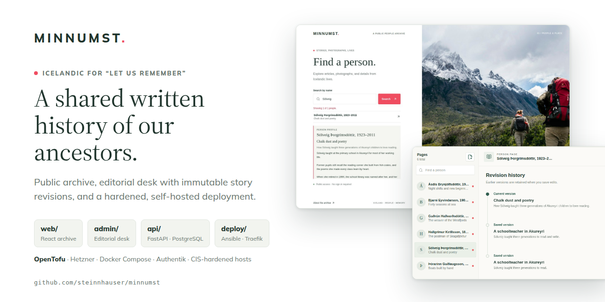
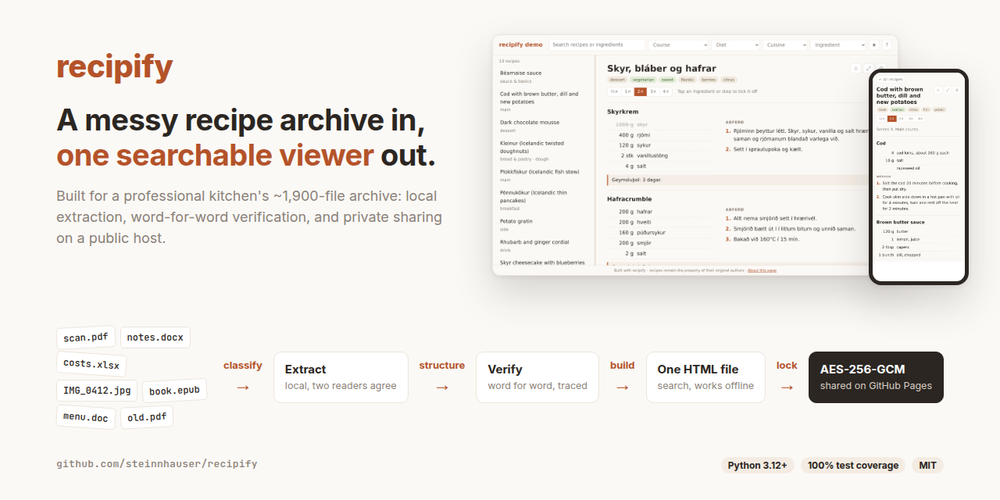

### Hi, I'm Steinn 👋

Cloud Operator in Berlin. I run Kubernetes platforms and automate the infrastructure around them.

I'm a physicist turned platform engineer. My path started in computational neuroscience, where I modelled brain signals at the University of Oslo. From there I moved into data science and NLP, then into building Azure microservices, and now I work in cloud operations at SENEC. I like systems that are secure by default, reproducible, and boring to run.

---

**Currently**

- ☸️ Operating large-scale Kubernetes clusters with Terragrunt, Helm, ArgoCD and GitLab CI/CD
- 🔐 Building secure, automated maintenance for 50+ Ansible-managed hosts over WireGuard, with a small Go client using mTLS
- 🏛️ Building [Minnumst](https://github.com/steinnhauser/minnumst) end to end, from the app to the hardened host it runs on (see below)
- 📍 Berlin, Germany · 🗣️ English, Icelandic, Norwegian, German

**Featured projects**

  
  

- **[Minnumst](https://github.com/steinnhauser/minnumst)**: a self-hosted family history archive (FastAPI, React, PostgreSQL). OpenTofu creates the Hetzner host, Ansible hardens it to the CIS benchmarks (scored with Lynis in CI), and Traefik with Authentik is the only way in. Releases are multi-arch images with an SBOM and build provenance.
- **[recipify](https://github.com/steinnhauser/recipify)**: a document-processing pipeline that turns ~1,900 mixed recipe files into 524 recipes, each checked word for word against its source and traceable back to it. 100% test coverage, with a [live demo](https://steinnhm.com/recipify/demo/) built by CI.

**Research & open source**

- [mne-python #13037](https://github.com/mne-tools/mne-python/pull/13037): cardiac artefact removal for spinal electrophysiology data, as a guest developer at the Max Planck Institute for Human Cognitive and Brain Sciences
- [Brain signal predictions from multi-scale networks](https://doi.org/10.1371/journal.pcbi.1010353): co-author, *PLoS Computational Biology* (2022)
- [MSc thesis, University of Oslo](https://github.com/steinnhauser/msc-thesis-lfp): approximate methods for computing extracellular potentials from neuronal networks, with Python and LFPy

**Tools I use most**

| Area | Tools |
| --- | --- |
| Platform | Kubernetes · Helm · ArgoCD · Docker |
| Infrastructure as code | Terraform / Terragrunt · OpenTofu · Ansible |
| Delivery | GitLab CI/CD · GitHub Actions |
| Cloud and operations | Azure · AWS · Prometheus / Grafana · Linux |
| Code | Go · Python · Bash |

**Certifications**

Microsoft Azure Administrator Associate ([AZ-104](https://learn.microsoft.com/en-us/users/steinnhausermagnusson-8948/credentials/e226b60f8028a1af)) · ITIL 4 Foundation

---

[Website](https://steinnhm.com) · [CV](https://steinnhm.com/cv/Steinn-Hauser-Magnusson-CV.pdf) · [LinkedIn](https://www.linkedin.com/in/steinnhauser) · [Email](mailto:hausersteinn@gmail.com)
